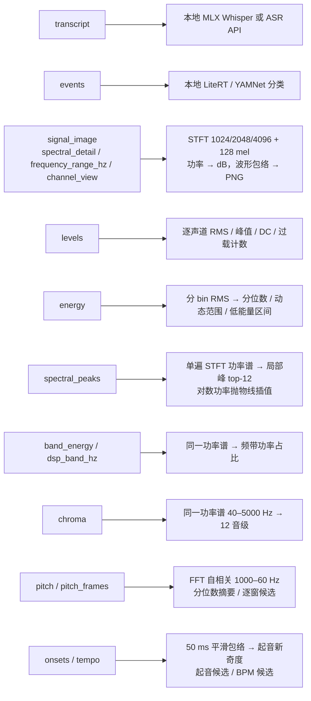

<h1 align="center">&nbsp;dsh-listen</h1>

<p align="center">让 LM Agent 听懂声音</p>

<p align="center">一个 DSH （DeepSeek Harness）的工具：传入音频，返回特征。</p>

## 安装

```sh
npm pack
dsh plugin --profile web add ./dsh-listen-0.1.2.tgz
```

卸载：`dsh plugin --profile web remove dsh-listen`。

## 成绩（MMAU）


`MMAU-test-mini` 1000 题：**74.60%**。

> 图中其他行取自 [MMAU 论文](https://arxiv.org/abs/2410.19168)结果表的 Test-mini 列，是早期版本数据、音频模型端到端；我们跑的是当前 `MMAU-v05.15.25` 修订版、文本模型加工具。


分域：sound 72.97、speech 82.58、music 68.26。

## 工具接口与返回

```js
listen({path:"x.wav", features:["levels","signal_image"], from:0, to:10})
```

| 参数 | 说明 |
|---|---|
| `path` / `attachment_id` | 来源，二选一；路径按会话工作目录解析 |
| `features` | 必填，无默认值：`transcript` `events` `signal_image` `levels` `energy` `spectral_peaks` `band_energy` `chroma` `pitch` `pitch_frames` `onsets` `tempo` |
| `from` / `to` | 源文件秒数，默认 0 / EOF；单次区间 ≤60 秒 |
| `spectral_detail` | `transient`/`balanced`/`tonal` → FFT 1024/2048/4096；只影响 `signal_image` |
| `frequency_range_hz` | 图上可见频段，不改计算频带 |
| `channel_view` | `separate`/`power_mean`；只影响出图 |
| `dsp_band_hz` | `[low, high]`；`band_energy` 必填 |

返回给模型的内容：

```json
{
  "status": "complete",
  "source": {"sha256": "…", "format": "wav", "sample_rate_hz": 48000, "channels": 2, "duration_seconds": 12.3},
  "coverage": {"from": 0, "to": 10},
  "requested_features": ["levels", "signal_image"],
  "available_features": ["levels", "signal_image"],
  "missing_features": [],
  "evidence": {
    "levels": {"status": "ready", "method": "signal-levels-v1", "units": {}, "parameters": {}, "channels": []},
    "signal_image": {"status": "ready", "method": "signal-image-v1", "parameters": {}}
  }
}
```

- 顶层 `status`：`complete` / `partial` / `failed`。
- `evidence` 每个键对应一个特征。值要么 `status: "ready"`，要么 `failed` / `unavailable` 加 `reason` 和错误码。
- 每块带 `method`、单位、实际生效参数。公共参数抽到 `parameter_sets`，块内用 `parameters_ref` 引用。
- `signal_image` 的图作为图片附件随结果返回，文本部分不含图。

## 设计

一个工具，可选拆成四个（`audio_signal`/`audio_transcript`/`audio_events`/`audio_dsp`）。把"听"拆成原子操作，让 Agent 自己组合。



参数语义见[设计基线](./docs/design/README.md)，各特征边界见 [DSP 证据](./docs/guides/dsp-evidence.md)。

## 兼容性

实测 `dsh` 0.2.1-rc.5 + Node 22 + macOS arm64。

## 开发

```sh
npm run gate:feature   # 静态检查 + 单元/覆盖率
npm run gate           # 静态检查 + 基础设施测试
```

## 许可

代码 MIT。可选运行时、权重、数据各按自己的许可。
