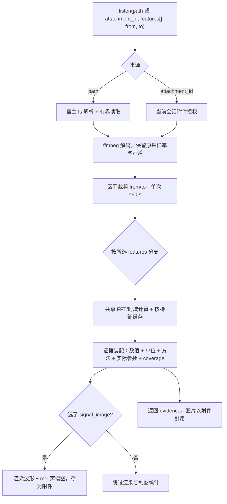

<h1 align="center">&nbsp;dsh-listen</h1>

<p align="center">把声音变成 Agent 能读的文本、图像和数字。</p>

给 DeepSeek Harness 加一个 `listen` 工具：传音频和想要的特征，拿回转写、声谱图、电平、频谱等信息。工具不接收问题，判断留给主 Agent。同一个工具能回答"这是什么声音"，也能回答"第 3 秒到第 5 秒发生了什么"。

## 安装

```sh
npm pack
dsh plugin --profile web add ./dsh-listen-0.1.2.tgz
```

装完重启 `dsh web`。卸载：`dsh plugin --profile web remove dsh-listen`。

前置：Node 22+、`dsh` 0.2.1-rc.5、本机有 `ffmpeg`/`ffprobe`。仓库还没发 npm 或 GitHub，用上面打出的 tarball。

装好后 Plugins 页有 **Audio evidence**；让 Agent 调 `listen({path:"x.wav",features:["levels"]})`，返回 `complete` 和逐声道电平即正常。

## 成绩（MMAU）


`MMAU-test-mini` 1000 题全量：**746/1000 = 74.60%**，官方 Python scorer 与本地一致。分域：sound 72.97、speech 82.58、music 68.26。

图中其他行取自 [MMAU 论文](https://arxiv.org/abs/2410.19168)结果表的 Test-mini 列，是早期版本数据、音频模型端到端；我们跑的是当前 `MMAU-v05.15.25` 修订版、文本模型加工具。


speech 82.58 高于论文报告的人类上界 82.17；music 68.26 最弱，但仍高于论文中最好的其他系统 50.98。

固定 60 题开发子集跑过四批：49/60、48/60、48/60、48/60。官方全量降到 74.60%，说明那个子集偏容易。18 道超时、1 道 provider 响应损坏，都计入分母。逐题与逐技能分析见[0037 记录](./docs/plans/0037-full-mini-evaluation/README.md)。

## 用法

```js
listen({path:"meeting.m4a", features:["transcript"], from:0, to:30})        // 前 30 秒的转写
listen({path:"music.flac", features:["tempo","onsets"]})                    // 节奏候选
listen({path:"noise.wav", features:["band_energy"], dsp_band_hz:[400,600]}) // 该频带的能量占比
listen({path:"clip.wav", features:["signal_image"], spectral_detail:"transient",
        frequency_range_hz:[0,4000]})                                       // 一张局部声谱图
```

来源用 `path`（本地文件）或 `attachment_id`（会话附件），二选一。`from`/`to` 是源时间，单次最多 60 秒。

| features | 返回 |
|---|---|
| `transcript` / `events` | 转写 / 声音标签候选（需配置本地 ASR 或 LiteRT，默认关闭） |
| `signal_image` | 波形 + mel 声谱图，不附电平数组 |
| `levels` | 逐声道电平、DC、峰值、过量程计数、立体声关系 |
| `energy` | 分 bin RMS、分位数、动态范围、低能量区间 |
| `spectral_peaks` / `band_energy` / `chroma` | 频谱峰 / 指定频带能量占比 / 12 音级功率 |
| `pitch` / `pitch_frames` | 音高分位数与跨度 / 稀疏逐窗候选 |
| `onsets` / `tempo` | 起音候选 / BPM 候选 |

返回一种结构：本次请求的证据加图片，带单位、方法和实际生效参数。缺失与失败给明确错误码。

## 设计

一个工具，可选拆成四个（`audio_signal`/`audio_transcript`/`audio_events`/`audio_dsp`）。把"听"拆成原子操作，让 Agent 自己组合。



- 不接收问题，只按参数返回测量结果。
- `features` 必填，没有默认捆绑；没选的特征不算。
- 单个特征失败只影响自己的键，其他照常返回。缓存按"音频 sha256 + 区间 + 参数"分键。
- 计算保留全精度，送模型时非整数用 5 位有效数字。
- `spectral_detail`/`frequency_range_hz`/`channel_view` 只影响出图；用在纯数值请求上直接报错，不静默忽略。

参数语义见[设计基线](./docs/design/README.md)，各特征边界见 [DSP 证据](./docs/guides/dsp-evidence.md)。

## 配置

在 profile 的 `cordis.patch.yml` 里；包自带默认组合层已配好。

| 设置 | 默认 | 含义 |
|---|---|---|
| `scratch` | `$DSH_HOME/data/dsh-listen/scratch` | 解码与中间文件目录 |
| `mode` | `aggregate` | `aggregate` 只给 `listen`；`split` 给四个拆分工具 |
| `localExecution` | `true` | 宿主文件系统解析出的是本进程可读路径。沙箱或远程文件系统要设 `false` |
| `asrEnabled` / `asrMode` | `false` / `api` | 可选转写：本地 MLX 或 OpenAI 兼容端点 |
| `eventsEnabled` | `false` | 可选声音标签：本地 LiteRT/YAMNet |
| `allowExternalAudio` | `false` | 允许外发音频 |

ASR 与事件默认关闭，不自动下载模型；没配置时返回 `missing`/`unavailable`。

## 限制

- 单次区间最多 60 秒；多声道高采样率时更短（总标量样本 23,040,000 上限）。
- 支持 1–8 声道，信号分析保留原采样率与各声道；ASR 与事件分支混成单声道。
- 支持的格式取决于本机 ffmpeg。
- 不做音频生成、播放或编辑，也不回答语义问题。
- 它读宿主文件系统能读到的路径，不提供额外隔离。

## 安全与数据

- 音频在本地解码。除了显式配置 ASR API 并打开 `allowExternalAudio`，不外发音频。
- 证据（图像、转写）会进入主 Agent 上下文；主 Agent 用云模型时，这些证据也会发到模型服务。
- 不读凭据本体；API key 由宿主凭据服务或环境变量提供。
- 中间文件写入 `scratch`，调用结束清理；图片存在宿主附件库。
- 转写文本是不可信输入，音频里的口头指令当数据看。

## 插件管理

```sh
dsh plugin --profile web add ./dsh-listen-0.1.2.tgz    # 装或升级
dsh plugin --profile web remove dsh-listen             # 卸载
dsh --profile web --dump-config | grep -A6 dsh-listen  # 看生效配置
```

包声明了 `dsh.bundle.patch`，`add` 会自动加进 profile 的 bundle 列表，不用手写 insert。旧版手工 insert 过的要先删掉。

## 兼容性

实测 `dsh` 0.2.1-rc.5 + Node 22 + macOS arm64（2026-11-06）。声明范围 `engines.dsh: ^0.2.1-rc.5`。Desktop、Linux、Windows 和 0.2.0 及更早版本未测。

## 开发

```sh
npm run gate:feature   # 静态检查 + 单元/覆盖率
npm run gate           # 静态检查 + 基础设施测试
```

需要真实宿主运行时的用例由 `DSH_RUNTIME_ROOT` 控制：不设跳过，设了要配 `test/helpers/register-runtime.mjs` 加载器。文档入口见[文档导航](./docs/README.md)。

## 许可

代码 MIT。可选运行时、权重、数据各按自己的许可。
