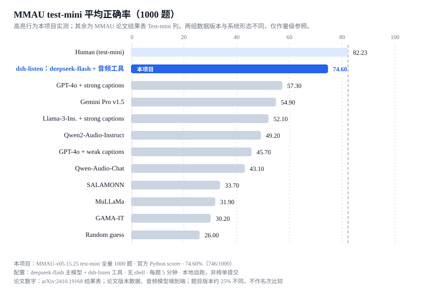
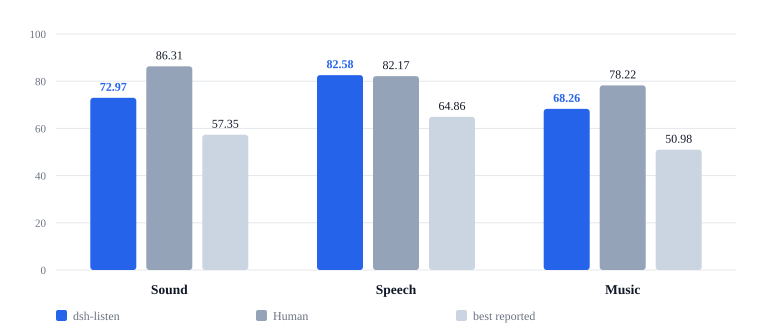
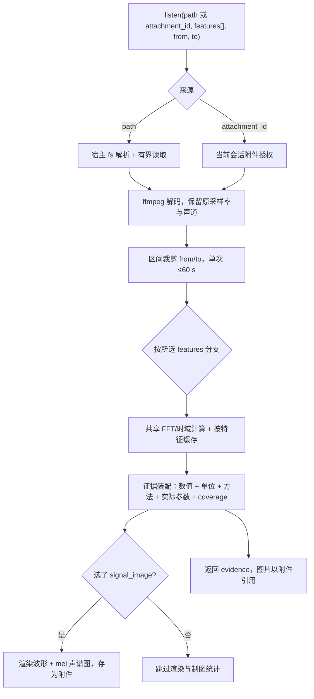

<h1 align="center">&nbsp;dsh-listen</h1>

<p align="center">让只有文本能力的 Agent 也能“听”：一次调用返回转写、声谱图和可读的数值证据。</p>

`dsh-listen` 是 DeepSeek Harness 的音频证据插件。它给 Agent 加一个 `listen` 工具：指定音频文件和想要的特征，拿回这一小段声音的文字、图像和数字。工具**不接收问题**，语义判断留在主 Agent——所以它既能回答“这是什么声音”，也能回答“第 3 秒到第 5 秒发生了什么”，而不需要为每种任务预置问答模型。

开发预览：已有实现、本地门禁与固定子集评测，未公开发布，完整验收未闭环（见 [工程状态](./docs/project/engineering-acceptance-status.md)）。

## 在 MMAU 上的位置



官方 `MMAU-test-mini` 全量 1000 题，`deepseek-flash` 做推理、`dsh-listen` 提供证据，官方 Python scorer 给出 **74.60%（746/1000）**，在这张参照表里仅次于人类上界。表中其余行来自 [MMAU 论文](https://arxiv.org/abs/2410.19168)结果表的 Test-mini 列（含“纯文本 LLM + 人工字幕”这条与我们最接近的路线：GPT-4o 强字幕 57.30）。两组数字的数据版本与系统形态不同——我们用的是当前 `MMAU-v05.15.25` 修订版、以工具形态作答，论文行是早期版本、音频模型端到端——所以只作量级参照，不作为名次声明；详见[评测结果](./docs/evaluation/results.md)。

分域看强弱项更清楚：



人声（Speech）是我们最强的一域：82.58，略高于论文报告的人类上界 82.17；环境声（Sound）72.97，音乐（Music）68.26 最弱。三域都明显高于论文中最好的其他系统（57.35 / 64.86 / 50.98）。逐题、逐技能与 18 个超时题的分析见[0037 运行记录](./docs/plans/0037-full-mini-evaluation/README.md)。

## 设计

只加**一个工具**（可选拆成四个），把"听"拆成 Agent 可以自己组合的原子操作：选特征、选时间窗、选显示方式，不用为每种问题准备一个问答模型。



内部几条关键取舍：

- **不接收问题**。工具不知道题面，只按参数返回测量结果；语义推理、要不要再听一遍，全在 Agent 侧。
- **只算所选**。`features` 必填、无默认礼包；没选 `signal_image` 就不做制图统计，没选数值特征就不算频谱统计。
- **失败隔离**。单个特征失败只让该键返回 `error` 状态，其他特征照常返回；缓存按"音频 sha256 + 区间 + 参数"分键，不会把不同区间或参数的结果混用。
- **计算与呈现分离**。数值底层保留完整精度，送给模型时非整数用 5 位有效数字；返回里带单位、方法与实际生效参数，但不附固定免责声明或解释性引导。
- **可组合的显示参数**。`spectral_detail` / `frequency_range_hz` / `channel_view` 只影响图像渲染；把它们用到纯数值请求上会被明确拒绝，而不是静默忽略。

完整的参数语义与契约见 [设计基线](./docs/design/README.md)，各特征的实测边界见 [DSP 证据说明](./docs/guides/dsp-evidence.md)。

## 30 秒安装

仓库尚未发布到 npm / GitHub，安装用本仓库打出的 tarball。前置：Node 22+、`dsh` 0.2.1-rc.5 左右、本机已有 `ffmpeg`/`ffprobe`。

```sh
# 在仓库根：打包（产物约 45 KiB）
npm pack

# 装进你要用的 profile（web 是 dsh web 用的那个；headless 适合脚本/评测）
dsh plugin --profile web add ./dsh-listen-0.1.0.tgz
```

- **生效条件**：重启或新开 `dsh web` 进程；装之前已经开着的会话不会出现这个工具。
- **装不上时**：最常见是 Node/ffmpeg 缺失或 `dsh` 版本过旧（包声明 `engines.dsh: ^0.2.1-rc.5`，不满足时直接拒绝安装）。
- **卸载**：`dsh plugin --profile web remove dsh-listen`。

### 装好之后怎么确认

1. Plugins 页能看到 **Audio evidence**（波形图标）。
2. 让 Agent 调一次：`listen({path:"some.wav", features:["levels","signal_image"]})`。
3. 期望拿到 `status: "complete"`、逐声道电平，以及一张波形+mel 声谱图。

## 为什么需要它

给 Agent 接音频通常只有两条路：接一个语音大模型做端到端问答（贵、不可控、不解释），或者自己写一堆 ffmpeg/DSP 脚本（每个任务重写）。`dsh-listen` 走第三条：**先把声音变成 Agent 能直接读的证据**，让主 Agent 用一次推理完成判断。

- 与“音频问答模型”不同：工具不替你下结论，也不读题面；它只给测量结果。
- 与“自己写脚本”不同：范围、声道、采样率、缓存、取消、超时都已处理，Agent 只需选特征。
- 默认零模型下载、零新增重型依赖：npm 闭包只有 `fft.js` 与 `pngjs`；ASR/事件标签是可选项，用你已有的本地环境。

## 用起来是什么样

```js
listen({path:"meeting.m4a", features:["transcript"], from:0, to:30})        // 只要前 30 秒的转写
listen({path:"music.flac", features:["tempo","onsets"]})                    // 只要节奏候选
listen({path:"noise.wav", features:["band_energy"], dsp_band_hz:[400,600]}) // 只要该频带的能量占比
listen({path:"clip.wav", features:["signal_image"], spectral_detail:"transient",
        frequency_range_hz:[0,4000], from:2, to:6})                         // 只要一张局部声谱图
```

只计算并返回你选的特征，没有“默认大礼包”。来源用 `path`（本地文件）或 `attachment_id`（会话里的音频附件），恰好一个；`from`/`to` 是源时间，单次区间上限 60 秒。

| features | 返回什么 |
|---|---|
| `transcript` / `events` | 转写 / 声音标签候选；需要你配置本地 ASR、LiteRT 环境（默认关闭） |
| `signal_image` | 波形 + mel 声谱图（图片），不附带电平数组 |
| `levels` | 逐声道电平、DC、峰值、过量程计数、立体声关系 |
| `energy` | 分 bin RMS、分位数、动态范围、低能量区间 |
| `spectral_peaks` / `band_energy` / `chroma` | 频谱峰 / 指定频带能量占比 / 12 音级功率 |
| `pitch` / `pitch_frames` | 音高分位数与跨度 / 稀疏逐窗候选 |
| `onsets` / `tempo` | 起音候选 / BPM 候选 |

返回结构固定一种：本次请求的证据 + 图片，带单位、方法与实际生效参数；缺失和错误都有明确代码，不伪装成静音或“处理完毕”。非整数以 5 位有效数字呈现，底层计算保留原始精度。

## 实测结果（MMAU）

固定子集：MMAU-test-mini 中每域 20 题共 60 题，题面/音频哈希固定；主模型 `deepseek-official/deepseek-flash`；无 shell，只有 `listen`/`read_image`；每题总截止 5 分钟，不限制工具调用次数。每批先盲态分析轨迹，再用官方 Python scorer 独立评分，两者一致。

| 批次 | 集合 | 正确率 | 环境声 / 人声 / 音乐 | 完成 / 超时 | 单题中位耗时 |
|---|---|---:|---|---|---:|
| A（10 分钟截止） | 固定 60 题 | 49/60 (81.7%) | 17 / 15 / 17 | 57 / 3 | 25.2 s |
| B | 固定 60 题 | 48/60 (80.0%) | 18 / 15 / 15 | 57 / 3 | 14.2 s |
| C（与 B 同代码） | 固定 60 题 | 48/60 (80.0%) | 15 / 16 / 17 | 59 / 1 | 12.3 s |
| D | 固定 60 题 | 48/60 (80.0%) | 15 / 17 / 16 | 58 / 2 | 9.8 s |
| **E（当前版本）** | **官方 1000 题全量** | **746/1000 (74.60%)** | 72.97% / 82.58% / 68.26% | 981 / 18 | 8.6 s |

E 批是官方 `MMAU-test-mini` 全部 1000 题（333 环境声 / 333 人声 / 334 音乐），官方 Python scorer 与本地匹配一致、无缺失预测；981 完成、18 超时、1 次 provider 侧响应损坏，都按规则计入分母。排除 30 道开发题后 725/970（74.74%），说明对已接触题目没有明显过拟合。难度分布：easy 75.5%、medium 76.1%、hard 70.3%。最弱的是时间推理（`Temporal Reasoning` 19/56）、情绪翻转（`Emotion Flip Detection` 9/20）、旋律结构（16/33）。

**这个分数在 benchmark 上的位置**，只能谨慎地说：MMAU 论文里 Gemini 1.5 Pro 是 66.15%、Qwen2-Audio 是 55.4%，但那是早期数据版本、且是音频大模型的端到端评测；我们用当前 `MMAU-v05.15.25` 修订版数据、以“文本模型 + 工具”的形态跑出 74.60%，**不同版本、不同系统形态，不能并排列名次**，也没有提交官方榜单。

怎么读这张表：

- **A–D 是同一固定子集的重复**。B/C/D 都是 80%，逐题看 44 题三批全对、7 题全错、9 题时对时错——域间几题的差别是采样波动，不要解读成某个改动的增益；E 换成官方全量后降到 74.6%，说明固定子集偏容易，这正是全量重跑的意义。
- **E 不是官方榜单提交**。它是本机自跑（官方数据 + 官方 scorer），没有提交到 MMAU 评测空间，也不与其他系统的榜单条目并排。
- **没有“无音频基线”对照**，因此不能声称“提升多少个百分点”；该项验收门槛仍未关闭（对照实验已被取消）。
- 失败集中在两类：长探索题用满 5 分钟（18 题，中位 51 次工具调用）；参数写错（36 次漏 `path`、少量 `from`/`to`/`dsp_band_hz` 类型错误）。

官方千题的 session 时间总和 40,769 秒、墙钟约 70 分钟（并发 10），用量 12.7M 输入 / 5.4M 输出 / 52.3M 缓存读取 tokens。

## 配置

配置项在 profile 的 `cordis.patch.yml` 里；包自带的默认组合层已经填好一组可用值。

| 设置 | 默认 | 含义 |
|---|---|---|
| `scratch` | `$DSH_HOME/data/dsh-listen/scratch` | 私有暂存目录，解码/中间文件只落这里 |
| `mode` | `aggregate` | `aggregate` 只给 `listen`；`split` 拆成 `audio_signal`/`audio_transcript`/`audio_events`/`audio_dsp` |
| `localExecution` | 包内默认 `true` | 表示宿主文件系统解析出的是本进程可读的真实路径；用沙箱/远程文件系统的手写 insert 应设 `false` |
| `asrEnabled` / `asrMode` | `false` / `api` | 可选转写：本地 MLX 或明确的 OpenAI 兼容端点 |
| `eventsEnabled` | `false` | 可选声音标签：本地 LiteRT/YAMNet |
| `allowExternalAudio` | `false` | 允许外发音频（需要你明确同意服务商与范围） |

ASR/事件默认关闭且不自动下载模型；没配置时返回 `missing`/`unavailable`，不会偷偷换云端。

## 限制

- 单次分析区间上限 60 秒；多声道高采样率时实际可用区间更短（总标量样本上限 23040000）。
- 支持 1–8 声道，信号分析保留原采样率与各声道；ASR/事件分支会显式混成单声道。
- 格式支持取决于本机 ffmpeg 与实测覆盖范围，未验证的格式不宣称支持。
- 不回答语义问题，不做音频生成/播放/编辑。
- 不是安全边界：它读的是宿主文件系统能读到的路径，宿主没有的隔离它也不会凭空提供。

## 安全与数据

- 音频只在本地解码；除你显式配置 ASR API 并打开 `allowExternalAudio` 外，不上传任何音频。
- 证据（图像、转写）进入主 Agent 上下文；主 Agent 用云模型时，这些证据也会发到模型服务。
- 不读取凭据本体；API key 由宿主凭据服务或环境变量提供。
- 中间文件写入 `scratch` 并在调用结束后清理；图片作为附件保存在宿主附件库。
- 转写文本属于**不可信输入**，音频里的口头指令是数据，不是命令。

## 插件管理

```sh
dsh plugin --profile web add ./dsh-listen-0.1.0.tgz    # 安装/升级（新版重新打包后重装）
dsh plugin --profile web remove dsh-listen             # 卸载
dsh --profile web --dump-config | grep -A6 dsh-listen  # 看实际生效的配置行
```

包声明了 `dsh.bundle.patch`，`dsh plugin add` 会自动把它加进 profile 的 bundle 列表，**不需要手写 insert**。若你按旧版手工插入过 `dsh-listen` 行，请先删掉，避免重复条目。装卸启停也可以用侧边栏 Plugins 页。

## 兼容性

| 项 | 值 |
|---|---|
| 实测宿主 | `dsh` 0.2.1-rc.5（2026-11-05/06，macOS arm64） |
| 声明范围 | `engines.dsh: ^0.2.1-rc.5`、`node >= 22` |
| 外部依赖 | `ffmpeg`/`ffprobe`（必需）；ASR/事件为可选本地环境 |
| 未测 | dsh Desktop、Linux/Windows、0.2.0 及更早版本 |

## 开发

工程入口见 [文档导航](./docs/README.md)：设计基线、评测协议、增量计划与验收状态。

```sh
npm run gate:feature   # 静态检查 + 单元/覆盖率门禁
npm run gate           # 静态检查 + 基础设施测试
```

需要真实宿主运行时的用例由 `DSH_RUNTIME_ROOT` 控制：未设置时跳过，设置后需配合 `test/helpers/register-runtime.mjs` 加载器执行。

## 许可

代码 MIT；可选运行时、权重、数据分别遵守各自许可，不随本代码许可自动变更。
